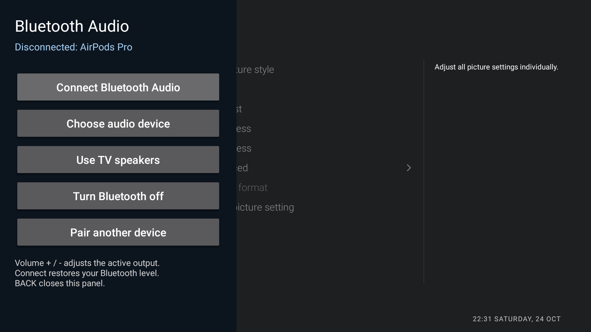

# Bluetooth audio on Philips TPM171E Android TV

I enabled the dormant **A2DP source** profile on a **Philips 43PUS6412/12**, fixed a missing pairing
confirmation, and built a remote-friendly **Bluetooth Audio** panel that slides over the left 40%
of the screen. The work was done on 2026-10-24, on Android 8.0 / firmware TPM171E_R.107.001.143.000.



Actual TV screenshot: the Bluetooth panel covers the left 40% while the settings screen remains visible.

The companion [Root-Philips-TV](https://github.com/mrk1987/Root-Philips-TV) documents how I obtained
Magisk 25.2 root. Root was used to enable the Bluetooth service component on this firmware;
the Bluetooth Audio panel itself runs without root.

## What worked

- RRO resource overlay + root `pm enable` + reboot enabled A2dpService.
- AirPods Pro bonded after promptly supplying Android's missing pairing confirmation.
- A2DP connected with **AAC**; audio-policy output, encoder PCM reads and audible playback were verified.
- Manual disconnect returned audio to TV speakers; reconnect and radio toggling worked.
- The blue remote button opened the panel (confirmed on the physical remote).
- Pressing the physical blue button again while the panel is open closes it (confirmed by the user).
  Both directions of the blue-button toggle have been verified on the real remote.
- The panel's generic device selector found the paired audio device. Other audio hardware has not
  been tested. Reboot reconnection and modern Android compatibility are unverified.

## 1. Enable the profile

See [the full enablement guide](docs/ENABLE-A2DP.md). This firmware already has a source stack,
encoder, audio HAL and policy module. Its Bluetooth APK has `profile_supported_a2dp=false` and a
service disabled by that resource. Both gates must be changed.

Source for the tiny, code-free overlay is in `overlay/`. Build it with its PowerShell script,
install it, enable the overlay, enable the service as root, then reboot:

```sh
adb install overlay/bt-a2dp-overlay.apk
adb shell cmd overlay enable --user 0 com.gathin.bt_a2dp_overlay
adb shell "su -c 'pm enable --user 0 com.android.bluetooth/.a2dp.A2dpService'"
adb shell "su -c reboot"
```

If installing over ADB is unreliable, push to `/data/local/tmp/` and use `pm install` on the TV.
A Bluetooth process restart alone did **not** apply the overlay in this experiment; reboot did.
No EdXposed, native library patch or global pairing-security downgrade is required.

## 2. Pair and connect

Open the stock accessory screen:

```sh
adb shell am start -n com.android.tv.settings/.accessories.AddAccessoryActivity
```

This TV failed to supply confirmation for pairing variant 2. The Bluetooth controller had been
misdiagnosed because the original log decoder used incorrect event codes. Event **0x33** is a
User Confirmation Request, not a passkey display notification. Peer capabilities are event **0x32**.

[PAIRING.md](docs/PAIRING.md) explains the corrected trace and the one-shot helper in `pairing/`.
The public helper takes the intended device address as an argument; no personal address is embedded.
Only confirm the owned device you deliberately put into pairing mode. The local fixed-address
prototype succeeded; the parameterized public variant must be validated on your own device.

## 3. Build and install the panel

See [panel/README.md](panel/README.md). With JDK 17 and Android SDK platform/build tools 34 installed:

```powershell
$env:JAVA_HOME='C:/path/to/jdk-17'
powershell.exe -NoProfile -ExecutionPolicy Bypass -File .\panel\build.ps1
```

Install the resulting `panel/bt-control.apk`. The panel provides **Connect Bluetooth Audio**,
**Choose audio device**, **Use TV speakers**, **Turn Bluetooth on/off**, and **Pair another device**.
It stores device selection and per-device volumes privately. It has no network permission,
analytics or embedded headset address. APKs are built locally; no signing key is distributed.

The panel targets API 26 and uses reflected Android 8 APIs. It is not advertised as a universal
modern Android Bluetooth app. No adapter and unavailable pairing screens are handled in the UI.
Underlying apps may pause; it is a translucent activity rather than a system overlay service.

## 4. Map the blue button

I used [cleanyourtv](https://github.com/Gathin23/cleanyourtv)'s HomeKeyService. In the existing theme
configuration add this item to `app_keys`, keeping all other entries:

```json
"KEYCODE_PROG_BLUE:com.gathin.btcontrol"
```

Reload HomeKeyService after the config change. On this TV Linux key 401 maps to PROG_BLUE.
The activity is `singleTask`: another launch while it is open calls `finish()`, so the same mapping
opens and closes the panel. Back also closes it. Other launchers need their own mapping mechanism.
The local launcher already had HOME mapping and stock-home redirect; those were preserved.

## 5. Volume findings

The TV stores speaker and A2DP music volumes separately (observed speaker 11/60, Bluetooth 40/60).
AVRCP mapped 40 -> 85/127 correctly. Identical numbers on speakers/headphones need not sound alike.
Maximum Bluetooth volume was loud enough, so no amplifier or gain patch was needed.

However, `Bluetooth.apk` has `a2dp_absolute_volume_initial_threshold=8`, and a reconnect dropped
Bluetooth volume from 40 to 8. The initial panel restored 8 -> 40 while speakers stayed at 11.
The generic panel saves a separate volume for each device and restores it when **Connect Bluetooth
Audio** completes. A new device has no high-volume default. Volume restoration runs while the panel
is resumed: wait for connection/restore before closing. Connections outside the panel still use the
firmware's behavior. The global threshold was not patched.

## Mistakes and abandoned paths

- The original HCI decoder used wrong event numbers and payload offsets; it falsely suggested a
  controller limitation. See [the corrected investigation](docs/PAIRING.md).
- A Just Works native-stack patch changed IO/auth fields but did not supply confirmation. It was
  disabled and the stock library restored. It is not distributed or needed.
- EdXposed/Riru was investigated, never needed for the working solution.
- A broadcast receiver from an unregistered `app_process` was rejected. A direct, one-shot API
  call worked instead.
- Raw pixel button sizes clipped scaled text. Density-based dimensions fixed the layout.
- A Windows source rewrite corrupted Unicode punctuation. UI source now uses ASCII and compiles as UTF-8.

## Undo

Remove the blue mapping and reload the key service to stop the shortcut. The panel can be disabled
with `pm disable-user --user 0 com.gathin.btcontrol`. Neither step removes the Bluetooth bond.

To undo profile enablement as well:

```sh
adb shell cmd overlay disable --user 0 com.gathin.bt_a2dp_overlay
adb shell "su -c 'pm disable --user 0 com.android.bluetooth/.a2dp.A2dpService'"
adb shell "su -c reboot"
```

Root rollback belongs to [Root-Philips-TV](https://github.com/mrk1987/Root-Philips-TV).
No firmware, system APK/vendor library, HCI capture, ADB key or private TV configuration is included.
Android-app playback was tested; HDMI/tuner routing was not validated and is not promised.
